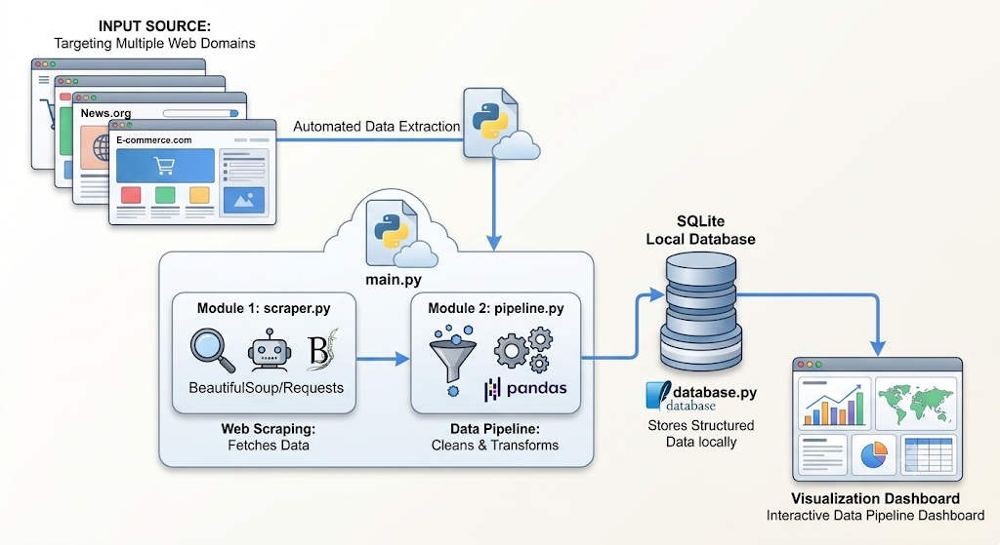

# AI-Powered Web Scraping & Data Pipeline Dashboard



A Python-based application for automated web data extraction, cleaning, and local storage in a lightweight SQLite database. This project provides a privacy-first, extensible foundation for scraping publicly accessible web content and transforming it into structured, useful data.

## Overview

The AI-Powered Web Scraping & Data Pipeline Dashboard is designed to help users collect publicly accessible web content, transform it into structured records, and persist the results locally for analysis, reporting, or future automation.

## Key Features

- Automated data extraction from target websites using Requests and BeautifulSoup
- Flexible selector-based scraping for title and body content fields
- Data cleaning and normalization using Pandas
- Local SQLite database storage for privacy-first, offline-friendly persistence
- Modular architecture that can be extended for new scraping tasks, transformations, and storage strategies

## System Architecture

```text
+-------------------+      +----------------------+      +------------------------+
| Target Website    | ---> | Web Scraper          | ---> | Data Pipeline          |
| (HTML Content)    |      | (Requests + BS4)      |      | (Pandas Cleaning)      |
+-------------------+      +----------------------+      +------------------------+
                                                                  |
                                                                  v
                                                       +--------------------+
                                                       | SQLite Database    |
                                                       | scraped_data.db    |
                                                       +--------------------+
```

## Project Structure

```text
.
├── main.py
├── scraper.py
├── pipeline.py
├── database.py
├── requirements.txt
├── .env.example
├── README.md
├── .gitignore
└── data/
```

## Requirements

- Python 3.10+
- Internet access to target websites
- Local environment capable of running Python scripts

## Installation

1. Clone the repository:

```bash
git clone https://github.com/solodevelopersai/Ai-Web-Scraper-Dashboard.git
cd Ai-Web-Scraper-Dashboard
```

2. Create and activate a virtual environment:

```bash
python -m venv .venv
source .venv/bin/activate  # Windows: .venv\Scripts\activate
```

3. Install dependencies:

```bash
pip install -r requirements.txt
```

4. Copy the example environment file:

```bash
cp .env.example .env
```

5. Update the environment variables if needed:

```env
TARGET_URL=https://example.com
SELECTOR_TITLE=title
SELECTOR_CONTENT=body
```

## Usage

Run the scraper pipeline:

```bash
python main.py
```

This command will:

1. Fetch the configured page
2. Extract the configured fields
3. Clean and normalize the scraped output
4. Save the structured records into SQLite

## Example Data Flow

```python
# main.py
scraper = WebScraper(target_url="https://example.com")
raw_data = scraper.fetch_and_extract({"title": "title", "content": "body"})

pipeline = DataPipeline()
cleaned_data = pipeline.process(raw_data)

db = DatabaseManager()
db.initialize_database()
db.insert_scraped_data(cleaned_data)
```

## Database

The project stores scraped data locally in SQLite under the `data/` folder. This keeps the workflow privacy-respecting and fully usable without a remote database dependency.

## Extending the Project

This starter kit can be expanded with:

- Multiple target URL support
- Automated scheduling
- JSON or CSV export
- AI-based classification or summarization
- Error logging and retries
- Dashboard UI with Streamlit or Flask

## Security Notes

- Respect website terms of use and robots.txt
- Avoid scraping protected or personal data without authorization
- Use data responsibly and in compliance with local laws and platform policies

## License

This project is a starter template for learning and experimentation.
